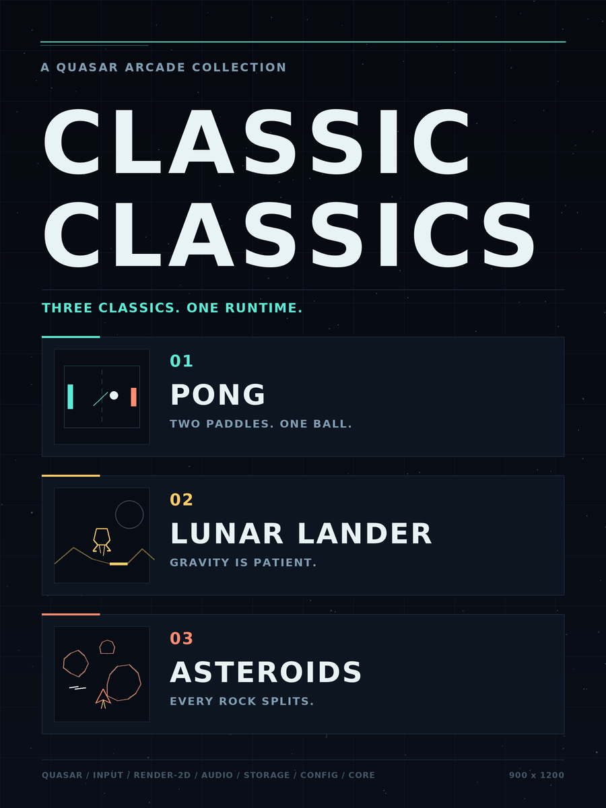

# Classic Classics

A single-window arcade collection built almost entirely from
[Quasar](https://github.com/HungLo2020/Quasar) infrastructure: Pong, Lunar
Lander, Asteroids, Micro Mages, Jackal, Missile Command and River Raid, with
vector and original pixel rendering, shared controls, persistent high scores
and a Basalt-ready Linux release.



This project follows the
[CODING-STANDARDS.md](https://github.com/HungLo2020/LinuxScripts/blob/master/CODING-STANDARDS.md)
and the [Basalt Game Standard](https://github.com/HungLo2020/Basalt/blob/main/STANDARDS.md).

## Games

| Game | Style | Rules |
|---|---|---|
| **Pong** | Neon arcade | First to seven. Solo versus the computer or local two-player. |
| **Lunar Lander** | Vector flight | Rotate and burn fuel to land softly, upright and on a multiplier pad. |
| **Asteroids** | Vector space | Inertial flight, wrap-around space, splitting rocks, three lives. |
| **Micro Mages** | Cooperative platforming | Original tower campaign, spells and jumping; 1–4 local players. |
| **Jackal** | Overhead action | Rescue prisoners and fight through six stages; 1–2 local players. |
| **Missile Command** | Arcade defense | Aim and fire three batteries to protect six cities. |
| **River Raid** | Scrolling shooter | Navigate the river, destroy targets and manage fuel. |

The catalog screen is the entry point. It uses a 1920×1080 logical canvas with
a three-column, two-row grid (six cards per page), and pages automatically as
games are added. The first page holds six games; River Raid is on page two.

The game starts in borderless fullscreen on the detected monitor, with a
1920×1080 fallback. Saved preferences and explicit `--windowed` or
`--resolution WxH` arguments take precedence.

Choose a game with **A/D**, **W/S** or
the arrow keys, then press **Enter**. **Escape** opens Settings from the catalog
or freezes a running game. **Backspace** returns from a game to the catalog.
**Q** always quits.

### Controls

| Action | Keyboard | Gamepad |
|---|---|---|
| Navigate catalog | W/S/A/D or arrows | D-pad or left stick |
| Confirm | Enter or Space | South |
| Settings | Escape | East |
| Back to catalog | Backspace | Select |
| Pong paddles | W/S, arrows in two-player | Left/right stick |
| Imported game movement / aim | WASD; mouse aim in Missile Command | D-pad or left stick |
| Imported primary fire | Left mouse | South / RT |
| Jump / right missile battery | Space or middle mouse | North |
| Grenade / left missile battery | Shift or right mouse | West |
| Imported player two | Arrows; Numpad 0 fire, 1 jump, 2 grenade | Second controller |
| Rotate ship / lander | A/D or Left/Right | Left stick |
| Thrust | W or Up | Triggers |
| Hyperspace | Shift | West |
| Pong mode | Tab | North |
| Pause | P | Start |
| Restart | R | LB |
| Mute | M | — |
| Fullscreen | F11 or Alt+Enter | — |
| Filter / scaling | F2 / F3 | — |

See [Imported games](docs/imported-games.md) for setup screens, multiplayer and per-game controls.

### Settings

**Escape** opens a settings overlay from either the catalog or a game. It freezes
the simulation and offers:

- **Fullscreen** — apply borderless fullscreen or return to the remembered window.
- **Resolution** — Auto (monitor), 800×500, 960×600, 1280×800, 1440×900,
  1600×1000 or 1920×1080. Borderless fullscreen always fills the native monitor;
  the selected dimensions are used when windowed.
- **Filtering** — Sharp (nearest) or Smooth (linear).
- **Scaling** — Fit or Integer.
- **Master volume** — adjust in 5% steps.
- **Mute** — toggle output without losing the saved volume.
- **Controls** — edit the global keyboard, mouse and gamepad action preset.
- **Back to catalog** — leave a running game and save its records.
- **Restore defaults** — reset display and audio settings.
- **Quit Classic Classics** — exit with status 0.

Changes apply immediately. Display and audio settings are written to
`data/config/display.toml` on a normal exit. **F11/Alt+Enter**, **F2** and **F3**
remain direct shortcuts outside the overlay.

Settings may also be supplied for one run through Quasar's common arguments.
Quasar reads TOML or JSON and resolves defaults, files and CLI overrides. The
saved file uses flat keys; explicit configuration also accepts `[window]`,
`[display]` and `[audio]` tables. `--set` uses `key=value`:

```sh
cargo run -- --config /tmp/display.toml --windowed --set width=1280 --set audio.volume=0.5
```

Existing `display.json` and `controls.json` preferences are loaded when the
corresponding TOML file is absent. A normal exit writes TOML while preserving the
legacy JSON. Invalid or newer files are preserved, including invalid TOML when a
legacy JSON file also exists. Records remain JSON and keep their existing schema.

### Global control mapping

Open **Settings → Controls** from the catalog or any game. The game stays frozen
while either menu is open. All games receive the same named actions and decide
what those actions do; physical keys and controller buttons belong to the shared
preset, not to individual games.

Choose **Gameplay**, **Menus**, **System** or **Player 2**. Each action has a visible
**Keyboard / Mouse** cell and a **Controller** cell. Assignments such as
`W OR UP` show every control currently assigned to that device.

- Click a cell, or use **arrows** to select it and **Enter** to change it.
- The capture dialog names the action and device, then asks for the new control.
  **Escape** cancels. Chords, mouse buttons, controller buttons and triggers work.
- For a paired action such as turning, the dialog asks for **Left**, then
  **Right** (or the corresponding controller stick movement).
- **Delete** clears the selected cell. **Restore Defaults** resets the preset.
  **Back** returns to Settings. Categories can be clicked, or reached with Up
  from the first row; Left/Right then changes categories.

Changing a cell replaces the assignments shown in that cell and preserves the
other device. For example, changing Keyboard / Mouse Fire from left mouse to F leaves its
controller buttons intact. Shared controls are allowed; identical assignments
are reported after capture.

Edits update Quasar's keyboard and gamepad bindings and HUD labels immediately,
and persist atomically to `data/config/shared/controls.toml` on normal exit.
`--no-save` and explicit `--bindings` presets remain temporary. Existing valid
presets are writable; corrupt/newer files are preserved. Old version-one presets
receive missing catalog axes, imported-game movement, jump and player-two actions.
Version-one default bindings migrate to Space for jump and left mouse for fire;
custom remaps and controller assignments are preserved.
Existing assignments and explicitly disabled actions are preserved.

Escape always provides access to Settings; arrow keys and Enter remain recovery
navigation inside Settings. These fixed recovery controls prevent an empty or
conflicting navigation mapping from locking the player out. During capture,
global actions (including quit and fullscreen) are isolated. Focus loss cancels
capture; controller axes must return to neutral before a new movement is captured.

Gamepads are hotplugged through Quasar's `gilrs` adapter and share the same
serializable action preset as the keyboard. An explicit preset can be tested
without changing the saved one:

```sh
cargo run -- --bindings /tmp/controls.toml
cargo run --no-default-features -- --write-default-bindings /tmp/controls.toml
cargo run --no-default-features -- --check-bindings /tmp/controls.toml
```

## Build and run

Requirements are a current stable Rust toolchain (1.94), CMake, Ninja or Make,
a C++ compiler, and the usual Linux window/audio/Vulkan development packages:

```sh
sudo apt install build-essential cmake ninja-build pkg-config \
  libxkbcommon-dev libxkbcommon-x11-0 libasound2-dev libudev-dev \
  libwayland-dev libx11-dev libxrandr-dev libxi-dev libxcursor-dev libvulkan-dev
cargo run
```

The native game needs a Vulkan 1.3 driver. Quasar's headless reference
renderer and every simulation run without a GPU or window:

```sh
cargo run --no-default-features -- --headless --ticks 2 \
  --screenshot /tmp/classicclassics-menu.png
cargo run --no-default-features -- --headless --game asteroids \
  --ticks 600 --autoplay --screenshot /tmp/asteroids.png \
  --state /tmp/asteroids.json
cargo run --no-default-features -- --headless --game asteroids --settings \
  --ticks 1 --screenshot /tmp/settings.png
```

Native smoke test (resizes, toggles fullscreen, changes filtering and scaling):

```sh
cargo run -- --game pong --autoplay --no-save \
  --smoke-frames 30 --exercise-window
```

## Workspace

The root `classicclassics` package is the executable and native/headless host.
Shared library code lives under `crates/`:

| Crate | Responsibility |
|---|---|
| `classicclassics-assets` | Shared Quasar asset mounts, typed image/audio loading and bounded cache |
| `classicclassics-core` | Game interface, input frames, sound events, HUD hints, drawing and simulation helpers |
| `classicclassics-collection` | Game registration, catalog, settings, controls, persistence and Quasar audio |
| `classicclassics-pong` | Pong simulation, rendering, records and catalog artwork |
| `classicclassics-lunar` | Lunar Lander simulation, rendering, records and catalog artwork |
| `classicclassics-asteroids` | Asteroids simulation, rendering, records and catalog artwork |
| `classicclassics-micromages` | Imported Micro Mages campaign, sprites and collection adapter |
| `classicclassics-jackal` | Imported Jackal campaign, sprites and collection adapter |
| `classicclassics-missile-command` | Imported Missile Command simulation, pixels and collection adapter |
| `classicclassics-river-raid` | Imported River Raid simulation, pixels and collection adapter |

Every game depends on the core API and Quasar's headless draw lists. File-backed
games also use the shared asset API; the collection supplies their mounts. Games
do not know about the application, other games or filesystem persistence. Versions and
Quasar dependencies are defined once in the root manifest. All crates are default
workspace members, so the normal test and Clippy commands cover the collection.
See [Adding a game](docs/adding-a-game.md) for the extension workflow.

## Quasar usage

Nothing in the game loop is hand-rolled infrastructure:

| Quasar crate | Used for |
|---|---|
| `quasar-assets` | Read-only game/embedded mounts, typed loaders, handles and bounded caching |
| `quasar-core` | Fixed 120 Hz step and shared viewport/scaling types |
| `quasar-window` | Native window, desktop identity, keyboard/mouse state, winit events |
| `quasar-input` | Named actions, bindings, edge detection, deadzones, controller hotplug |
| `quasar-ui` | Shared controls editor widgets, layout, focus and isolated rebinding |
| `quasar-render-2d` | Ordered quad draw lists, bitmap font, GPU presentation, headless rasterisation |
| `quasar-audio` | Generated effects, original Ogg/WAV clips, music buses and optional CPAL output |
| `quasar-storage` | Basalt directory discovery and atomic JSON persistence |
| `quasar-config` | Common CLI/environment parsing (`--headless`, `--resolution`, `--no-audio`, …) |

The vector look is produced with Quasar's public canvas API: rotated thin
quads become lines, polylines, circles and polygon outlines. The same draw list
is presented on the GPU and rasterised headlessly, so screenshots do not need a
separate renderer.

## Data and Basalt layout

The release is a single binary plus artwork and original game assets. On first run the game creates only
the directories it needs and honors every Basalt directory variable, falling
back to paths relative to the install root when run outside Basalt.

```text
<install root>/
├── app/                       release-owned: executable, artwork, license, games/ assets
└── data/
    ├── save/records.json      synced high scores and progress
    ├── config/display.toml    machine-local window/audio settings
    ├── config/shared/controls.toml  portable bindings preset
    └── cache/                 reserved for rebuildable files
```

Records and JSON exports are written through `quasar_storage::write_json`, which writes a
temporary file in the same directory, syncs it and renames it into place.
Existing corrupt or newer files are preserved and defaults are used; nothing is
ever written into `app/`. TOML preferences use the same atomic temporary-file,
sync and rename pattern in the collection crate, because Quasar 0.2.16 only
provides a JSON writer.

## Release and catalog

The root catalog entry is [`ClassicClassics.json`](ClassicClassics.json). Copy it
to `~/.config/basalt/games/` to try it locally:

```sh
cp ClassicClassics.json ~/.config/basalt/games/
basalt catalog
basalt install ClassicClassics --library default
```

Normal commits and pushes run **CI only**. Publishing is a separate explicit
operation through the project's [release skill](.agents/skills/release/SKILL.md).
The manual **Release** workflow requires the full SHA of the current `main`
commit and successful CI for that exact SHA:

```sh
gh workflow run release.yml --ref main -f commit=<full-commit-sha>
```

Publication reuses one GitHub Release named and tagged **Latest**, replacing its
Linux ZIP and moving that tag to the tested commit. It removes the previous
version's matching ZIP instead of accumulating releases/assets. Concurrent
releases are serialized; a stale commit cannot replace a newer main build.
The replacement is uploaded and checked before the old ZIP is removed. The
workflow also retains its Actions artifact for three days. The release skill
downloads and compares both artifacts after publication.

The release asset is `ClassicClassics-<version>-linux-x64.zip` and contains only
`app/`, so Basalt can replace the release without touching `data/`. To build and
inspect a local archive:

```sh
python3 DevUtils/package.py
python3 DevUtils/verify_package.py dist/ClassicClassics-*-linux-x64.zip
```

## Documentation

- [Adding a game](docs/adding-a-game.md) — crate contract and registration
- [Shared assets](docs/assets.md) — Quasar mounts, loading, ownership and recovery
- [Architecture](docs/architecture.md) — simulation, rendering, input and host boundaries
- [Basalt compliance](docs/basalt-compliance.md) — the standard's checklist, item by item
- [Imported games](docs/imported-games.md) — source provenance, adapters, controls and assets
- [Testing](docs/testing.md) — deterministic, headless and native verification

## AGENTS

`AGENTS.md` is a symbolic link to this README; the README is the single source
of truth for agent instructions.

- Read this document and the linked coding standards before changing the project.
- Prefer Quasar crates for timing, windowing, input, rendering, audio, storage and configuration. Do not add parallel infrastructure without a documented reason.
- Keep each game in its own crate, implementing `classicclassics_core::ArcadeGame`.
  Register games in `classicclassics-collection/src/games.rs`; keep game crates
  independent of the collection and other games.
- Keep every game a pure fixed-step simulation with a draw list. Headless tests must continue to run with `--no-default-features`.
- Preserve imported simulations and assets; maintain them in this workspace. See `docs/imported-games.md` and each game’s `UPSTREAM.md`. Do not change the original repositories.
- Never write to `app/` at runtime. Progress goes to `data/save/`, machine settings to `data/config/`, portable settings to `data/config/shared/`, rebuildable files to `data/cache/`.
- Write JSON user data atomically through `quasar_storage`. TOML configuration
  uses the collection's `config_file` adapter because Quasar has no TOML writer.
- Keep the root catalog entry and release asset names in sync with the Basalt standard.
- Keep global controls in `Session::controls`, and apply them to Quasar input
  states through the desktop host's `sync_controls`. Games interpret the shared
  logical `Input`; never hardcode physical bindings in game crates.
- Keep settings changes flowing through `Session::settings`; the desktop host applies them through `sync_settings`, and the simulation never calls the window, renderer or audio device directly.
- Run `cargo fmt --all -- --check`, `cargo clippy --locked --all-targets -- -D warnings`, `cargo test --locked`, and `cargo test --locked --no-default-features` before finishing.
- Normal commits and pushes run CI only. Publish only when the user explicitly
  invokes the `release` skill or asks for a release; use the manual workflow and
  replace only the rolling `Latest` tag/release.
- To commit and push, invoke the `commit-and-push` skill explicitly; it verifies local checks and watches every GitHub Actions workflow for the pushed commit.
- Do not modify other projects or repositories as part of work here.
